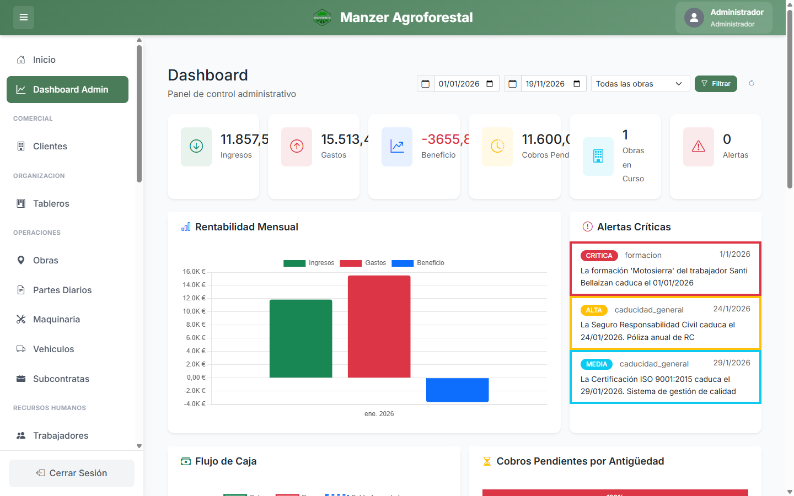
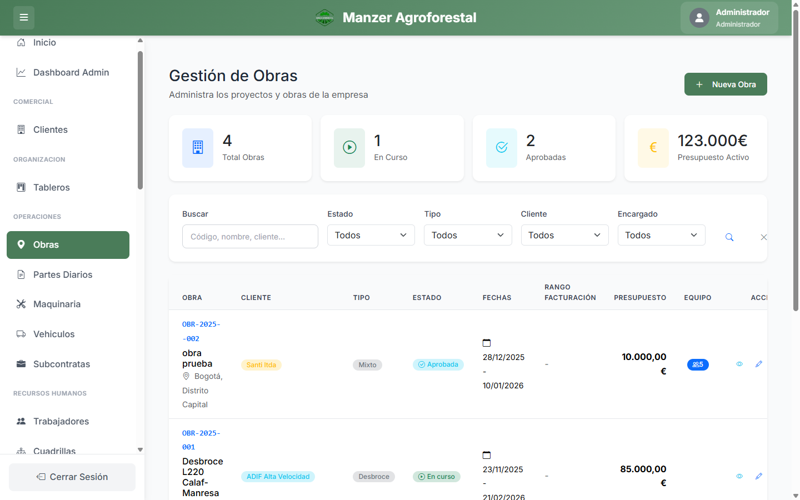
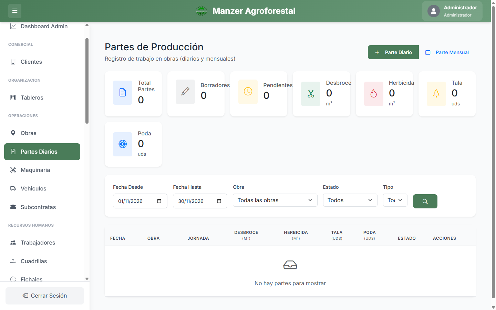
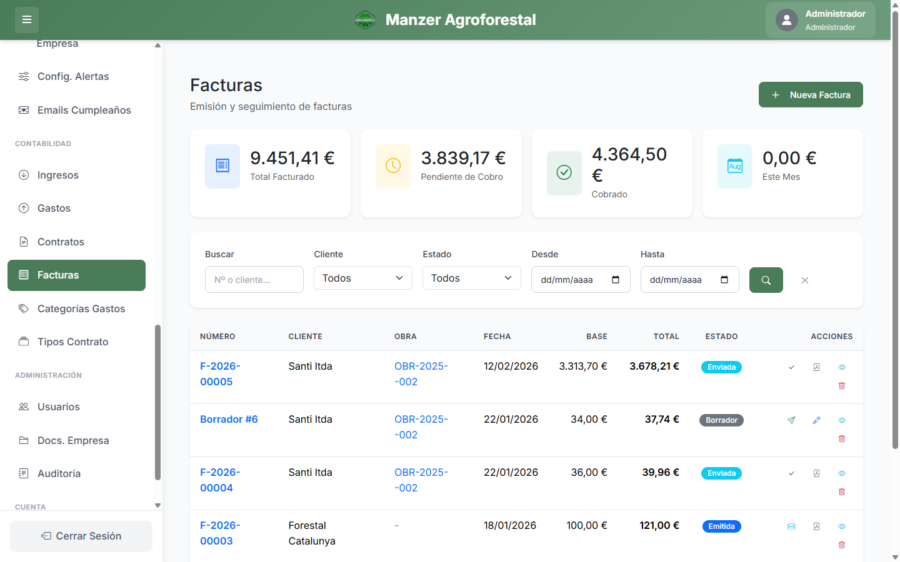
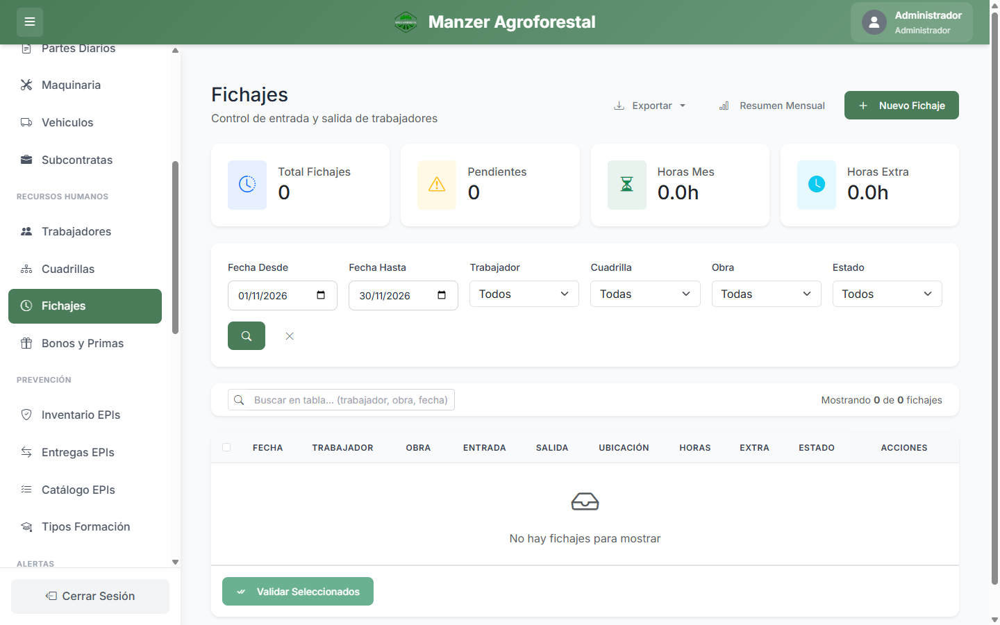
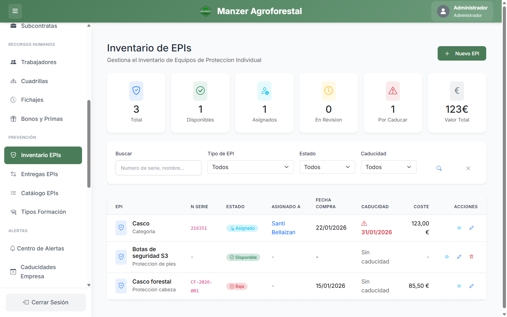

# Manzer Agroforestal — ERP de operaciones y contabilidad

ERP para una empresa de trabajos forestales en España (desbroce, tala, poda, herbicida): obras, partes de producción, personal, maquinaria, prevención de riesgos y facturación.



## Contexto

La empresa coordina cuadrillas en varias obras a la vez y debe cumplir con normativa de prevención (EPIs, formación, certificaciones). La información estaba en hojas de cálculo separadas; el sistema la unifica y avisa antes de que algo caduque.

## Funcionalidades

- **Obras:** presupuesto, cliente, tipo de trabajo, estado y equipo asignado; tableros de seguimiento.
- **Partes diarios y mensuales de producción** (m² de desbroce y herbicida, unidades de tala y poda).
- **Recursos humanos:** trabajadores, cuadrillas, **fichajes** de entrada/salida con horas extra, bonos y primas.
- **Maquinaria, vehículos y subcontratas.**
- **Prevención:** inventario y entrega de EPIs, catálogo, revisiones y tipos de formación.
- **Alertas y caducidades:** formaciones, seguros y certificaciones con niveles de criticidad y notificaciones por correo.
- **Contabilidad:** ingresos, gastos por categoría, contratos, facturas (borrador → emitida → enviada → cobrada) y dashboard de rentabilidad mensual y flujo de caja.
- **CRM básico** (leads e interacciones), documentos de empresa, emails de cumpleaños y **auditoría** de acciones.

## Stack

- **Backend:** PHP 8, Laravel 9, MySQL/MariaDB
- **Autenticación y permisos:** Laravel Breeze + spatie/laravel-permission (roles y permisos)
- **Frontend:** Blade, Livewire, Alpine.js, Tailwind CSS, Bootstrap, DataTables, Chart.js
- **Documentos:** DomPDF, Laravel Excel

## Capturas

**Gestión de obras**



**Partes de producción**



**Facturación**



**Fichajes del personal**



**Inventario de EPIs**



## Instalación local

Requisitos: PHP 8.0+ (con extensiones `gd`, `zip`, `intl`), Composer, Node 18+ y MySQL/MariaDB.

```bash
git clone <url-del-repositorio>
cd manzer
composer install
npm install && npm run build
cp .env.example .env        # configura la conexión a la base de datos
php artisan key:generate
php artisan migrate --seed
php artisan serve
```

La aplicación queda disponible en `http://localhost:8000`. Los seeders crean los roles y datos iniciales (revisa `database/seeders`).

## Notas

- Proyecto desarrollado para un cliente real y desplegado en producción. Las capturas se tomaron en un entorno local; el historial de este repositorio se depuró para no incluir credenciales ni copias de bases de datos.

## Autor

**Santiago Bellaizán** — Desarrollador Full Stack (Laravel · PHP · MySQL · JavaScript)

- GitHub: [@Santibc](https://github.com/Santibc)
